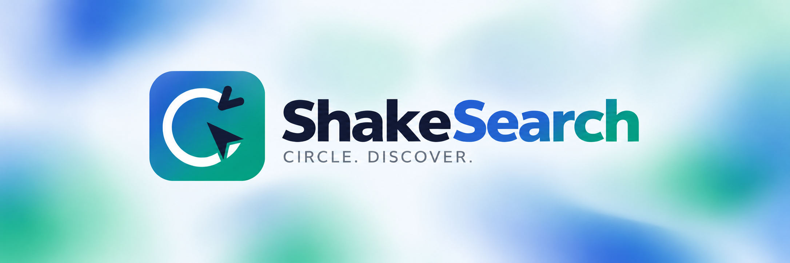

# ShakeSearch



ShakeSearch is an experimental open-source project for Windows that brings an AI-powered screen selection tool to your desktop. It is inspired by features like Google's Magic Pointer and Circle to Search, but it is an independent project with no affiliation with Google.

## Purpose

ShakeSearch lets you select any area of your screen by shaking your mouse or using Select area. Once you circle an area, a drawer window opens with:

- A preview of the captured image
- Google Lens results about the image
- A text input to ask custom questions about the selection
- An option to copy the captured image
- A text viewer to extract, edit and copy text from the capture
- An experimental Google Lens search with an optional question and follow-ups

## Features

- **Quick capture:** shake the mouse or click **Seleziona area**, then circle an area on any connected monitor. A moving ultramarine glow marks the screen edges during selection.
- **Smarter selection:** nearby rectangles can snap to their edges. Hold **Shift** to skip snapping, or adjust the selection by dragging its corners and edges before pressing **Enter**.
- **Lens chat:** view results and ask questions about the capture using Google Lens. The drawer can be expanded with **F11**.
- **Copy image and text:** copy the capture to the clipboard, or open it in a separate window to recognize, edit and copy its text.
- **Google Lens (experimental):** send the image and an optional question to Lens. Complete any Google consent in the Lens window; available results and source links appear in the chat, with the original Lens results. Follow-up questions can use the same image session.
- **Italian and English:** switch languages from the chat. The choice is saved for future captures and windows.

The Lens integration relies on Google web pages, which can change or require verification. Its live flow still needs verification on Windows; see the Lens section below for details.

Circle to Search is Google's visual search feature for supported Android phones. It lets you circle, highlight, scribble over or tap something on the screen to search for it with Google without leaving the app you are using.

Google explains the original Android feature in its [introduction to Circle to Search](https://blog.google/products/search/google-circle-to-search-android/). ShakeSearch takes inspiration from its screen selection gesture and is developed independently of Google.

ShakeSearch currently provides Google Lens results and answers about the selected content. The experimental **Invia a Lens** option sends the selection to Google Lens and reads available results into the ShakeSearch chat through an internal web session.

It runs locally on Windows and sends selected images and questions to Google Lens. No API key is required.

**This is experimental software.** It is provided as-is without warranty. Use it at your own risk. The project is not affiliated with, endorsed by, or connected to Google LLC or any of its products.

## What you can use it for

Use ShakeSearch when you want help with something you see on your screen. Circle a picture to ask what it shows, select an error message to ask for help, or extract text from a screenshot instead of typing it again. You can also copy a selected part of the screen to paste into another app. If your selection is not quite right, adjust its edges before confirming. You do not need to draw a perfect shape.

## Requirements

- Windows 10 or Windows 11
- Python 3.10 or newer (64-bit)
- Microsoft Edge WebView2 Runtime (required by the chat window on Windows)

## Installation

1. Download or clone this repository:

   ```powershell
   git clone https://github.com/vin10122/shakesearch-for-windows.git
   cd shakesearch-for-windows
   ```

2. Install the Python dependencies:

   ```powershell
   python -m pip install -r requirements.txt
   ```

3. Run the application:

   ```powershell
   python shakesearch.py
   ```

## How to use

- Shake your mouse quickly or click Select area in the control window to activate the screen capture.
- A darkened overlay appears over your screen.
- Click and drag to draw a circle around the area you want to select.
- Nearby visible rectangles are detected locally and the selection snaps to their edges.
- Hold Shift when releasing the mouse to keep a free selection.
- Before confirming, drag the ultramarine-blue handles at the corners or along any edge to refine the rectangle.
- Press Enter to confirm the selection, or Esc to cancel and try again.
- A drawer window opens showing the captured image and Lens search controls.
- Type a question in the input box at the bottom to ask about the image.
- Click **Copia immagine** to copy the original capture to the Windows clipboard. A message confirms the copy or explains an error.
- Click **Apri immagine per copiare testo** to open the image alongside its recognized text.
- To query Lens in the chat, add an optional question under **Cerca con Google Lens** and click **Invia a Lens**. Follow-up questions in the chat use Lens and the same image session.

Choose **Italiano** or **English** from the selector at the top of the chat.
The chat controls change immediately, and new capture overlays and text-viewer
windows use the saved language. The language requested
from Google Lens follow this choice. Existing messages and text transcribed from
images keep their original content. Italian is the default; the preference is
saved locally in `%LOCALAPPDATA%\ShakeSearch\settings.json` on Windows.

## Files

| File | Description |
|------|-------------|
| shakesearch.py | Main application: input listeners, Qt screen capture, session management |
| overlay.py | Qt selection overlay and ultramarine-blue plasma animation |
| rectangle_snap.py | Local rectangle detection and selection alignment |
| drawer.py | Drawer window: image preview, Lens chat |
| localization.py | Italian/English interface catalog and saved language preference |
| window_shape.py | Native rounded drawer clipping on Windows to remove the outer rectangular backing |
| ocr_viewer.py | Image viewer with editable text recognition and clipboard support |
| image_clipboard.py | Windows clipboard image transfer (DIB and PNG) |
| lens_upload.py | Direct Python multipart upload and Lens response validation |
| lens_handoff.py | Standalone browser-handoff helper |
| lens_session.py | Isolated internal Lens session and reading of visible results |
| lens_process.py | Nonblocking Lens request queue and child-process management |
| lens_worker.py | Dedicated Lens WebView process and persistent consent profile |
| browser_window.py | Standalone browser-launch helper |
| requirements.txt | Python dependencies |
| .gitignore | Files excluded from version control |

## Capture animation

The interface uses an ultramarine-blue accent (`#3447B8`) and a dark blue-gray container
(`#22262D`), with matching colors in the image text viewer and capture overlay.
On Windows, the native drawer is clipped to the rounded panel so the surrounding
rectangle does not cover the desktop. Fullscreen restores the full window area.

The capture overlay uses Qt (PySide6). On each monitor, an ultramarine-blue plasma wave
moves from the edges to the center, returns to the edges, then fades to a thin
ultramarine-blue perimeter line with a continuously moving highlight. The sequence takes
2.8 seconds and requests a frame every 16 ms (about 60 updates per second, subject
to display refresh rate and rendering performance). Selection stays available
throughout. After the opening sequence, only the border area is repainted. Screenshots remain at their native resolution, including on mixed-DPI
monitor setups.

After updating an existing installation, install the new Qt dependency:

```powershell
python -m pip install -r requirements.txt
python shakesearch.py
```

## Rectangle snapping

Draw roughly around a card, window, image or other rectangle. ShakeSearch checks
nearby screen edges and aligns the selection when it finds a close match, including
rectangles with rounded corners. If no reliable match is found, your original
selection is kept. Hold **Shift when releasing the mouse** to skip alignment.

Before pressing **Enter**, drag any ultramarine-blue corner handle or edge to adjust the
selection. Manual adjustments are kept without snapping again. The selection
stays within the screen and cannot shrink below 25 logical pixels per side.
Nothing is sent to the chat until you confirm with Enter; Esc clears the selection.

Detection uses OpenCV locally in a background thread; screenshots are not sent to
an AI service for alignment. Rotated shapes and rectangles without clear visible
edges may require a free selection. Install updated requirements after upgrading.

## Copy text from an image

In the chat drawer, choose **Apri immagine per copiare testo**. A separate window
shows the captured image with zoom controls and extracts its text using the
Google Lens. This requires an Internet connection and uses Google Lens, not local recognition. The text viewer uses its own Lens profile, separate from the chat.

The extracted text is selectable and editable. Use **Copia testo** to copy the
selected portion, or all text when nothing is selected. **Ctrl+C** copies a text
selection as usual. Use **Rileggi testo** to retry recognition. Empty results,
request failures and truncated text are shown in the window.

## Google Lens in the chat (experimental)

Enter an optional question in **Cerca con Google Lens** and click **Invia a Lens**.
This opens the internal Google Lens window immediately. Complete any consent,
sign-in or verification request there. ShakeSearch automatically uploads the
captured image from that same browser session, reads the resulting text and
source links into the chat.
The Lens window opens at the current chat window size and stays visible so you can interact with Google directly. All chat questions and follow-ups use the same Lens image session. Results and source links are displayed directly, without an external AI interpretation service or API key.

Menus, headers, footers and generic page links are excluded. The reader accepts
structured result cards, visual matches and recognized answer blocks, rather than
the full page text. If Google opens its homepage instead of search results, the
chat reports that problem without opening another window. If no
readable results are found, the chat reports an error. No additional API
key or public image-hosting service is used; the image is sent directly to Google.

The Google window has no access to ShakeSearch's application API. ShakeSearch
never chooses consent options or solves a verification for you. Consent prompts
on Google's own results page are detected too. A repeated prompt reuses the
same window instead of rejecting the request because consent was already shown.
Consent waiting is bounded; redirects do not continually renew its time limit.

The image is submitted from Google's page using the WebView's own cookies.
Cookies are not transferred back to a separate HTTP client after consent.
Closing the Lens window cancels a pending search; closing the chat stops its
Lens process as well.

Google's consent choice is retained in ShakeSearch's dedicated WebView profile
under `%LOCALAPPDATA%\ShakeSearch\LensProfile` on Windows, separately from the
chat's `WebViewProfile`. Only one chat can use the Lens profile at a time; another
chat reports that Lens is already active instead of opening a competing reader.
Cookies are managed
by the WebView and are not extracted into Python or copied from your default browser.

This uses Google's web upload endpoint and result pages, not an official Lens API. Page structure,
image-session lifetime and support for follow-up questions can change. Automated
checks inspect the real multipart encoding sent by the HTTP client and cover
rejected uploads, DOM extraction, session reuse and chat rendering with simulated
Google responses, plus cancellation and timeouts with a deliberately stalled
worker process. **The live Google flow still needs verification on
Windows**, because Google access is blocked in the cloud development environment.

The upload host is `lens.google.com`, as configured in
[Chromium's Lens configuration](https://github.com/chromium/chromium/blob/main/components/lens/lens_features.cc).

## Troubleshooting

If image copying reports a missing dependency, run `python -m pip install -r requirements.txt` to install `pywin32` on Windows.

On Windows, application and chat-process logs are written to
`%TEMP%\shakesearch.log`. Open them with:

```powershell
notepad "$env:TEMP\shakesearch.log"
```

## Development checks

Run the Qt rendering, input, multi-monitor lifecycle and crop tests without a desktop:

```bash
QT_QPA_PLATFORM=offscreen python -m unittest discover -s tests -v
```

For the optional internal Lens chat check (Google pages are simulated, so this
does not validate live Google results):

```bash
python -m pip install playwright
python -m playwright install chromium
python tests/check_lens_chat_browser.py
python tests/check_lens_reader_browser.py
python tests/check_lens_consent_browser.py
python tests/check_language_browser.py
```

## License

MIT License

## Disclaimer

This project is experimental. It uses Google Lens. Screen captures are processed by an external service. Do not use this tool to capture sensitive or private information unless you understand and accept the privacy implications of sending images to Google.

## Portable Windows EXE

To build the portable Windows x64 version, use Python 3.12 x64 on Windows:

```powershell
powershell -ExecutionPolicy Bypass -File packaging/build-windows.ps1
```

The script uses a separate build environment, runs the test suite, and packages
`dist/ShakeSearch-windows-x64.zip`. Extract the entire ZIP and launch
`ShakeSearch/ShakeSearch.exe`; keep its `_internal` folder alongside it.
Python is included. Microsoft Edge WebView2 Runtime is still required.
Chat, Lens, and the text viewer run as isolated roles of the same executable.

You can also run **Windows portable build** manually from GitHub Actions;
version tags (`v*`) trigger it too. Download the ZIP from the workflow artifacts.
The build is unsigned and still needs an interactive Windows smoke test covering
capture, chat, Lens consent/results, text viewing, clipboard, and child cleanup.


### Startup and configuration

The terminal remains visible and a persistent control window shows that ShakeSearch
is active. Use **Select area** to capture manually, **Settings** to change options,
or **Quit** to stop the app. Closing the control window also stops the app.
There is no Alt+F7 shortcut.

On first launch (including upgrades without saved setup preferences), choose the
interface language, mouse-shake activation, sensitivity, and animation mode.
Preferences are stored in `%LOCALAPPDATA%\ShakeSearch\settings.json`; they are
independent of the extracted portable folder. Canceling initial setup exits without
saving. The light animation mode shows only the border. Balanced mode requests
about 60 updates per second during the opening effect and 30 afterward; these
are timer targets, not measured presentation rates.
